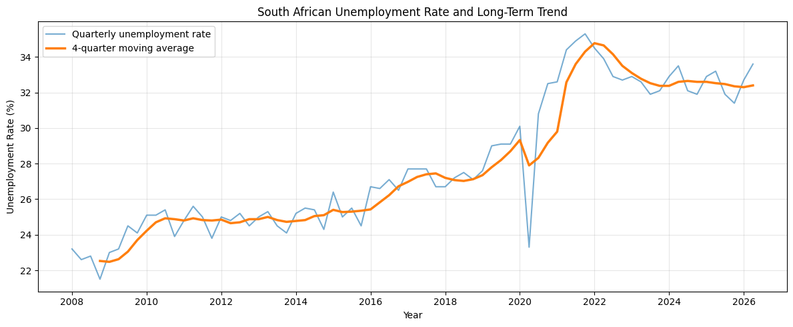
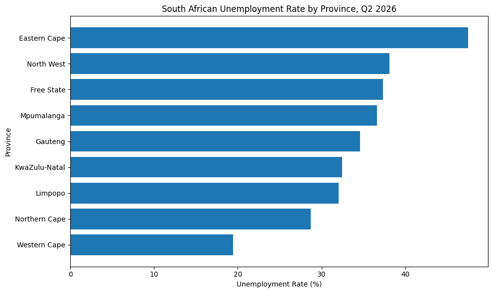
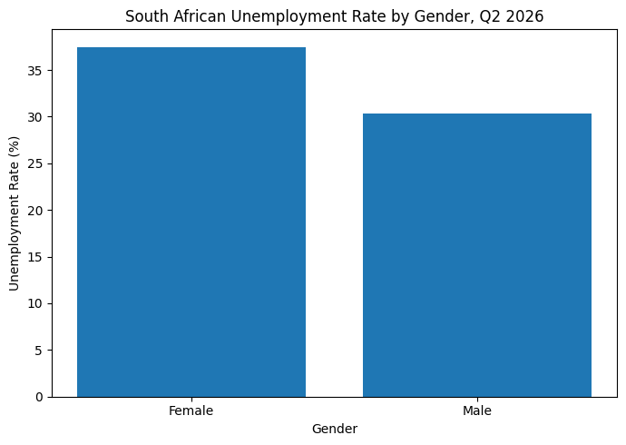
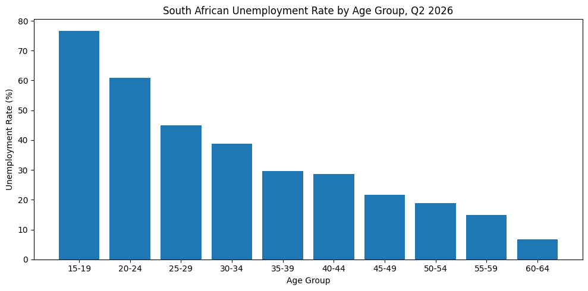
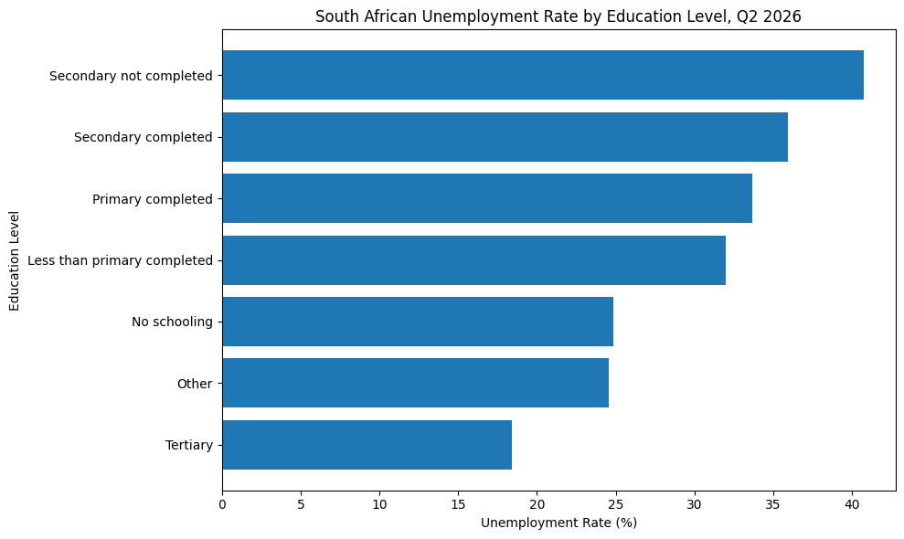
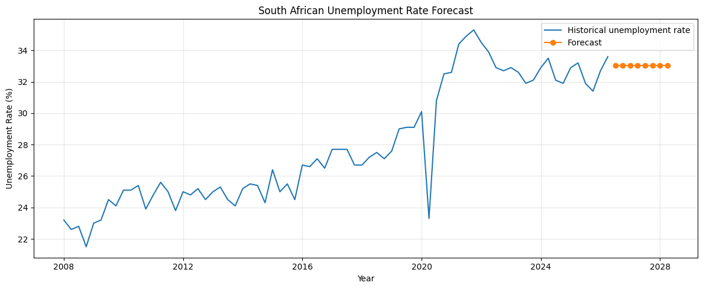

# South African Labour Market Analysis

## About the project

I built this project to explore unemployment in South Africa using official Statistics South Africa (Stats SA) labour-market data.

The project combines two types of QLFS data:

- national quarterly unemployment trends from **2008 Q1 to 2026 Q2**
- QLFS microdata for **2026 Q2**

I used the data to look at how unemployment has changed over time, how it differs across provinces and demographic groups, which factors are associated with unemployment, and what recent patterns suggest about the next few quarters.

The project includes data cleaning, exploratory analysis, hypothesis testing, logistic regression and time-series forecasting.

## Questions I wanted to answer

1. How has South Africa's unemployment rate changed over time?
2. Which provinces have the highest and lowest unemployment rates?
3. How does unemployment differ by gender, age and education?
4. How serious is youth labour-market exclusion?
5. Are employment status and demographic or geographic characteristics statistically related?
6. Which factors are associated with unemployment?
7. Is the national unemployment series stationary?
8. Which performs better for this data: ARIMA or ETS?
9. What does the selected model suggest about unemployment over the next several quarters?

## Data

The data comes from the **Statistics South Africa Quarterly Labour Force Survey (QLFS)**.

I used:

- **QLFS Trends 2008–2026 Q2** for the national quarterly unemployment series
- **QLFS 2026 Q2 unit-record data** for the provincial and demographic analysis

The cleaned national time-series dataset used in the project is stored here:

`data/south_africa_unemployment_2008_2026.csv`

For the provincial and demographic estimates, I used the QLFS survey weights.

## Main findings

### Unemployment has risen over the long run

The national series contains **74 quarterly observations** from 2008 Q1 to 2026 Q2.

Across the full period, the average unemployment rate was about **27.94%**. The lowest rate in the data was **21.5% in 2008 Q4**, while the highest was **35.3% in 2021 Q4**.



The graph shows a clear long-term rise in unemployment, especially from the late 2010s into the early 2020s.

There are also unusually large movements around the COVID-19 period, so those quarters need to be interpreted carefully.

### Provincial differences are large

The Q2 2026 weighted estimates show major differences between provinces.

The **Eastern Cape** had the highest estimated unemployment rate at about **47.5%**, while the **Western Cape** had the lowest at about **19.5%**.



### Women had a higher unemployment rate than men

For Q2 2026, the weighted unemployment rate was approximately:

- **37.4% for women**
- **30.3% for men**



### Younger people face the highest unemployment rates

Unemployment is much higher among younger age groups and generally falls as age increases.

Some of the approximate Q2 2026 rates were:

- **77%** for ages 15–19
- **61%** for ages 20–24
- **45%** for ages 25–29

The weighted **NEET rate for people aged 15–34 was 45.38%**.



### Education is also linked to unemployment outcomes

People with tertiary education had the lowest unemployment rate among the education groups in this analysis.



This shows an association between education and labour-market outcomes, but it should not be interpreted as proof that education alone causes the difference.

## Hypothesis testing

I used chi-square tests to check whether employment status was associated with gender and province in the sample.

### Gender and employment status

- Chi-square statistic: **105.569**
- Degrees of freedom: **1**
- p-value: **< 0.001**

The result suggests a statistically significant association between gender and employment status in the sample.

### Province and employment status

- Chi-square statistic: **425.994**
- Degrees of freedom: **8**
- p-value: **< 0.001**

The result also suggests a statistically significant association between province and employment status.

## Logistic regression

I fitted a logistic regression model with unemployment status as the outcome variable and gender, age, education and province as predictors.

Some of the main results were:

- **Male odds ratio: 0.650** — males had lower estimated odds of unemployment than females, holding the other variables constant.
- **Age odds ratio: 0.936** — each additional year of age was associated with lower estimated odds of unemployment.
- **Tertiary education odds ratio: 0.349** relative to the reference education category.
- **Western Cape odds ratio: 0.302** relative to Eastern Cape.

The model was statistically significant overall.

These results show associations rather than causal effects.

## Time-series forecasting

Before fitting the forecasting models, I tested the national unemployment series for stationarity using the Augmented Dickey-Fuller test.

For the original series:

- ADF statistic: **-0.9637**
- p-value: **0.7663**

The series was therefore treated as non-stationary.

After first differencing:

- ADF statistic: **-8.1253**
- p-value: **< 0.001**

The differenced series was stationary.

I then compared several ARIMA and ETS models using the final eight quarters as a test set.

### Best ARIMA model

**ARIMA(0,1,1)**

- MAE: **0.804**
- RMSE: **0.973**

### Best ETS model

**ETS — Level only**

- MAE: **0.800**
- RMSE: **0.968**

The ETS level-only model performed slightly better than ARIMA(0,1,1) on the holdout period.

Its eight-quarter forecast suggests that unemployment may remain broadly around **33%**, rather than showing a strong upward or downward trend.



## Project structure

```text
South-Africa-Labour-Market-Analysis/
│
├── README.md
├── .gitignore
│
├── data/
│   └── south_africa_unemployment_2008_2026.csv
│
├── notebooks/
│   ├── 01_data_loading_and_exploration.ipynb
│   ├── 02_data_cleaning_and_validation.ipynb
│   ├── 03_exploratory_data_analysis.ipynb
│   ├── 04_provincial_and_demographic_analysis.ipynb
│   ├── 05_hypothesis_testing.ipynb
│   ├── 06_regression_analysis.ipynb
│   └── 07_time_series_forecasting.ipynb
│
└── visuals/
    ├── unemployment_long_term_trend.png
    ├── unemployment_by_province.png
    ├── unemployment_by_gender.png
    ├── unemployment_by_age.png
    ├── unemployment_by_education.png
    └── unemployment_forecast.png
```

## Notebooks

| Notebook | What it covers |
|---|---|
| [01 — Data Loading and Exploration](notebooks/01_data_loading_and_exploration.ipynb) | Loading the data and checking its structure |
| [02 — Data Cleaning and Validation](notebooks/02_data_cleaning_and_validation.ipynb) | Cleaning and validating the national unemployment series |
| [03 — Exploratory Data Analysis](notebooks/03_exploratory_data_analysis.ipynb) | Descriptive statistics, trends and visualisations |
| [04 — Provincial and Demographic Analysis](notebooks/04_provincial_and_demographic_analysis.ipynb) | Province, gender, age, education and youth analysis |
| [05 — Hypothesis Testing](notebooks/05_hypothesis_testing.ipynb) | Chi-square tests for labour-market differences |
| [06 — Regression Analysis](notebooks/06_regression_analysis.ipynb) | Logistic regression of unemployment status |
| [07 — Time-Series Forecasting](notebooks/07_time_series_forecasting.ipynb) | Stationarity testing, ARIMA, ETS and forecasting |

## Tools and methods

I used:

- Python
- Google Colab
- Pandas
- NumPy
- Matplotlib
- SciPy
- Statsmodels
- Scikit-learn
- Exploratory data analysis
- Weighted survey estimates
- Chi-square tests
- Logistic regression
- Augmented Dickey-Fuller testing
- ARIMA
- Exponential Smoothing / ETS
- MAE and RMSE for forecast evaluation

## Limitations

The QLFS uses a complex survey design. I used survey weights for the provincial and demographic unemployment estimates, but the chi-square tests were based on raw sample counts.

The logistic regression is also exploratory and does not fully adjust for the QLFS survey design.

The forecasting section uses a relatively short quarterly series and a limited set of ARIMA and ETS specifications. The forecasts should therefore be treated as model-based projections rather than certain future outcomes.

## Data source

**Statistics South Africa (Stats SA)  Quarterly Labour Force Survey (QLFS)**

The analysis, code and interpretation in this repository were produced as part of this project using Stats SA data.

## Status

✅ Core analysis completed.

## Author

**Tom Ntaba**

Aspiring Statistical / Data Analyst
